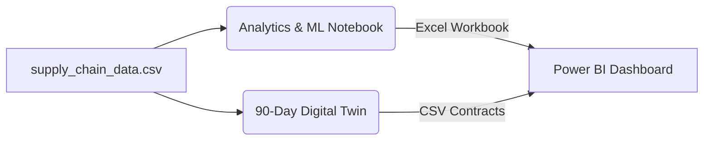

<div align="center">

# 📦 Supply Chain Intelligence Hub & Digital Twin
**End-to-End Supply Chain Analytics, Machine Learning & Policy Simulator**

**Python** • **Scikit-Learn** • **Power BI**

*Transforming static SKU telemetry into composite health scores, ML risk clusters, 90-day Monte Carlo simulations, and interactive executive dashboards.*

</div>

---

## 💡 What This Project Does

1. **Scores & Segments Operations (Python & Scikit-Learn):** Cleans supply chain data, computes composite health scores (`Inventory`, `Supplier`, `Logistics`, `Cost`), and runs K-Means clustering and Random Forest models.
2. **Simulates Supply Chain Policies (Python Digital Twin):** Runs **300 Monte Carlo simulations** over a **90-day horizon** to test reorder points, safety stock, and supplier improvements against stockouts.
3. **Visualizes Insights (Power BI):** Combines exported multi-sheet Excel workbooks and simulation CSV contracts into interactive executive dashboards.

---

## 🔄 How It Works



---

## 🧩 Project Components

<details>
<summary><b>1. 🧠 Supply Chain Analytics & ML Pipeline (Click to expand)</b></summary>
<br>

An end-to-end Jupyter/Deepnote workflow (`supply_chain_data.csv` → `Supply_Chain_Intelligence_Hub.xlsx`) featuring:
* **Composite KPI Scoring (0–100):** Calculates `Inventory_Health_Score`, `Supplier_Performance_Score`, `Logistics_Efficiency_Score`, and `Cost_Efficiency_Score`.
* **Profitability & EDA:** Tracks revenue ($577.6K), costs ($52.9K), net profit ($524.7K), and SKU-level profit margins across product types, routes, and carriers.
* **Machine Learning Models:**
  * **Product Segmentation:** K-Means clustering with PCA dimensionality reduction (`k=6` clusters).
  * **Supplier Risk Scoring:** Weighted risk indexing and Random Forest feature importance modeling.
  * **Cost Prediction:** Benchmarking Linear Regression vs. Random Forest regressors.

</details>

<details>
<summary><b>2. 🎲 90-Day Stochastic Digital Twin (Click to expand)</b></summary>
<br>

Simulates daily Poisson demand, log-normal lead time jitter, and binomial defect rates across **4 policy scenarios**:

| Scenario | Reorder Point / Safety Stock | Key Policy Adjustments | Business Goal |
| :--- | :---: | :--- | :--- |
| **`baseline`** | 5 days / 1 day | Current order quantities & lead times | Benchmark current operations |
| **`recommended`** | 8 days / 3 days | +15% order qty, -12% lead time, -15% defects, -5% ship cost | Balanced service & margin growth |
| **`resilience`** | 10 days / 5 days | +25% order qty, -18% lead time, -20% defects, +3% ship cost | Maximum stockout protection |
| **`lean`** | 5 days / 1 day | -10% order qty, -5% lead time, -8% ship cost | Minimize holding & shipping costs |

</details>

<details>
<summary><b>3. 📊 Power BI Dashboard (Click to expand)</b></summary>
<br>

Connects to `Supply_Chain_Intelligence_Hub.xlsx` and the Digital Twin CSV outputs (`scenario_summary.csv`, `daily_twin_state.csv`, `sku_risk_register.csv`) to display:
* **Executive Overview:** Total revenue, net profit, defect rates, and composite health gauges.
* **Supplier & Logistics Benchmarking:** Carrier efficiency, route transit times, and supplier risk tiers.
* **What-If Policy Explorer:** 90-day inventory trajectories, stockout SKU-days, and `P05`–`P95` confidence intervals.

</details>

---

## 🚀 Quickstart

### Step 1: Run the Analytics & ML Notebook
```bash
pip install pandas numpy matplotlib seaborn scipy scikit-learn openpyxl
```
Execute the notebook cells to generate `Executive_KPI_Table.xlsx` and `Supply_Chain_Intelligence_Hub.xlsx`.

### Step 2: Run the 90-Day Digital Twin
```bash
python supply_chain_digital_twin.py \
  --input supply_chain_data.csv \
  --output-dir digital_twin_output \
  --days 90 \
  --runs 300
```

### Step 3: Refresh Power BI
Open the `.pbix` report file, update the data source paths to point to the generated `.xlsx` workbook and `digital_twin_output/` folder, and click **Refresh**.
